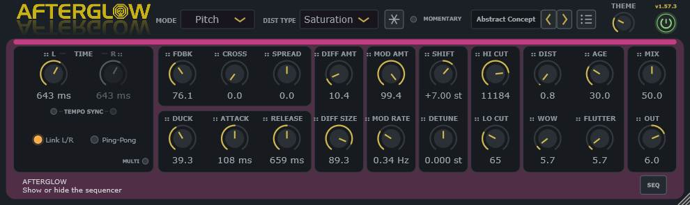
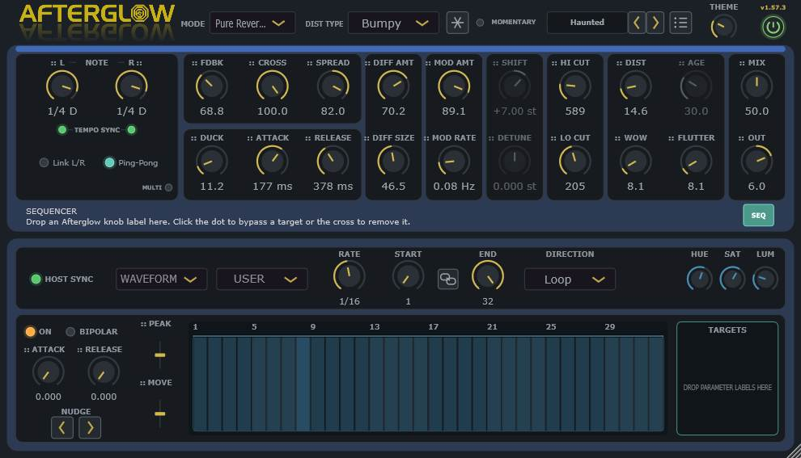
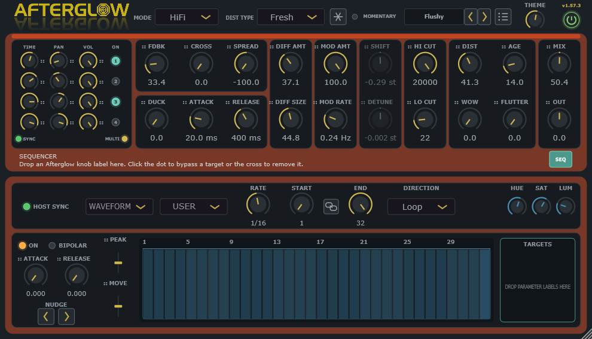

# Afterglow

Afterglow is a stereo VST3 delay by sl23 for the Dead Channel Audio plugin suite.

Credits: Many thanks to Artvera for the logo.

## Build and installation

Project root: `_Projects\Afterglow`, beside the shared `_Projects\_Tools` folder.

1. Save the current PolyHostInterface project because the build closes PHI automatically.
2. Double-click `- Build.bat`.
3. Wait until `BUILD SUMMARY` shows all four checks as `PASS`.
4. Use the portable Windows x64 plugin at `dist\Afterglow.vst3`.
5. If the build fails, send the newly generated `Results.log`.

The build uses JUCE 9.0.4, CMake 4.4.2 and Visual Studio Community 2026 x64 from the existing shared tool folders. It does not install the plugin automatically.

## Current delay modes

### Digital

Uses dual read-head crossfades when the delay time changes. This avoids intentional varispeed pitch sweeps and keeps ordinary timing changes clean. Mod Amount and Rate drive a smoothly rounded triangle LFO whose physical excursion follows the delay time: short delays stay concentrated in the flanging range, while delays of 250 ms and longer can use the complete 35 ms range. Single uses matched left/right motion, Dual uses 90-degree quadrature, and Ratio and Ping-Pong use 180-degree antiphase movement. At flanger-length times, only the part that would cross the 0.25 ms safety floor moves forwards. Age reduces the floating-converter resolution from pristine to deliberately coarse without adding analogue drift or wear.

### Tape I

Uses a continuously moving read head, delay-time-dependent drift, two-stage high-frequency head loss and soft tape saturation. Age progressively increases bandwidth wear and compression.

### Tape II

Uses a separate inertia-based transport that continuously accelerates, glides and decelerates towards a changed Time setting. Its bounded varispeed avoids an instantaneous or mechanically linear pitch ramp, while a warm two-stage head response, subtle inherent wow/flutter and level-compensated asymmetric magnetic colour produce a smoother tape echo. Age increases bandwidth wear and magnetic compression. Stereo and Multi-Tap timing use the same transport model.

### Colour

Uses independent responsive virtual-clock read heads for the Left and Right Time controls. Moving either Time produces one continuous Doppler glide instead of switching or crossfading between delay positions. The effective playback speed remains between 0.25x and 4x, while four-point cubic interpolation keeps both the waveform and its slope continuous during slow sweeps, quick changes and direction reversals. Mod, Wow and Flutter move those same bounded virtual-clock targets instead of being applied after the transport, keeping automated movement as fluid as manual Time changes without allowing a read head to stall or reverse. Age morphs continuously from the exact clean cubic read at 0% into restrained companding, progressively softer bandwidth, very low signal-tracked texture and asymmetric saturation. This processing sits in the repeat path so its character accumulates naturally through Feedback. EQ and DIST remain available, and Stereo and Multi-Tap timing use the same movement and character model.

### HiFi

Uses continuous varispeed delay movement like a studio reel-to-reel delay, while remaining much brighter and cleaner than Tape I. Gentle inherent saturation and drift distinguish it from Digital; Age adds restrained bandwidth wear and asperity texture.

### Brigade

Models a deliberately dark bucket-brigade delay with two-stage, delay-dependent bandwidth loss, continuous clock movement, companding, progressively coarser resolution, signal-tracking noise and stronger controlled saturation.

### Ghost

Uses a continuously moving analogue-style delay feeding a quadrature frequency shifter. Shift moves both channels from -1000 to +1000 Hz with fine resolution around zero; Detune adds 0-100 Hz of left/right separation around that central value. The spectral displacement accumulates naturally through the feedback loop, including Multi-Tap, while Age progressively darkens and saturates the shifted repeats.

### Pitch

Uses two overlapping, windowed read heads per channel to transpose each delayed return from -24 to +24 semitones. Detune offsets the left and right shifts around that central value. Age reduces the floating-converter resolution. The result enters the feedback loop, so the selected interval accumulates across successive repeats rather than acting as a one-off tonal treatment.

### Pitch Rev

Uses two overlapping reversed grains per channel and places their transposed result inside the feedback loop. Each Time control sets that channel's splice length; Shift changes reverse playback pitch and Detune offsets the channels around it. Below 40 ms, the overlap progressively focuses around each micro-splice so settings such as 7.0/4.3 ms remain distinctly granular without creating hard boundaries. Age reduces the floating-converter resolution. Above-unity regeneration includes a small fixed loss proportional to transposition distance, allowing large shifts to move out of band and decay instead of locking the saturator into a permanent sub-bass tone. The result is a reversed, pitch-moving wash rather than Pitch mode played backwards after the delay.

### LoFi

Uses a deliberately worn-tape path with permanent two-stage bandwidth loss, level instability, asymmetric odd/even harmonic colour, coarse texture and signal-tracking hiss. Stereo-decorrelated random drift, inherent wow/flutter and scrape motion remain active before any controls are raised, while Mod Amount, Mod Rate and Age intensify the instability. Its nonlinear stage is level-normalised so the character no longer masquerades as a longer or louder feedback decay.

### Crystal

Uses a pristine bright digital path with smoothly rounded triangle-wave modulation and a nearly colourless soft-knee feedback limiter. Low Cut, High Cut and a steep Age-controlled low-pass filter colour the audible return outside the feedback loop, so the repeats retain their brightness instead of becoming progressively darker on every circulation.

### Phaser

Places a selectable 2/4/6/8/10/12-stage stereo phaser inside the regenerating delay path. Mod Amount controls notch-sweep depth, Mod Rate controls speed, RES controls internal resonance and STAGE changes the notch count. AGE remains visible but disabled. All twelve stages stay warmed and stage changes crossfade smoothly instead of exposing cold filter state or switching abruptly. A fixed resonance-derived gain normalises only the Phaser signal returning to the outer delay loop, so Feedback below 100% remains decaying even when a sweeping resonant peak is stronger than unity; the audible first echo and Phaser resonance remain unattenuated.

### Pitch Lush

Combines a pitch-shifted delay voice with a second stereo-detuned voice at the same overall delay time. Shift sets the main transposition, Detune separates the channels in both voices, and P MIX blends continuously from the detuned voice at 0% to the shifted voice at 100%. The combined result enters feedback so shimmer-like pitch structures build across repeats.

### Chromatic

Uses its own continuous tape path with a cleaner transport, brighter two-stage head response, restrained inherent wow/flutter and higher feedback headroom than Tape I. Age moves from open and clean to dark, compressed head wear, while the mode deliberately omits tape-noise and splice-style artefacts.

### Analogue

Uses a brighter, quieter bucket-brigade path with roughly twice Brigade's working bandwidth, finer companding resolution, restrained clock motion and approximately half its noise. Age progressively narrows the bandwidth, raises the clock texture and drives a thicker asymmetric analogue saturation stage.

### Chaotic

Uses independently wandering delay intervals and pitch ratios for the two channels. The motion is smoothly interpolated rather than stepped, remains inside bounded delay and pitch ranges, and regenerates through the feedback path to form evolving forward patterns.

### Pure Reverse

Uses overlapping reverse grains at the original pitch. Each Time control sets the grain length, while Feedback layers the reversed material without introducing the transposition of Pitch Rev.

### Chaotic Rev

Combines overlapping reverse grains with the independently wandering delay and pitch motion of Chaotic. Feedback produces tumbling, irregular reverse layers while all motion and return levels remain bounded.

### Forward Rev

Pairs a clear forward audible repeat with a separate reverse-grain regeneration path. The reverse feedback path has independent filtering and diffusion state, allowing a clouded reverse tail without smearing the first forward echo.

## Controls

### Timing and routing

- Independent Left and Right delay times from 1 to 2000 ms with 0.1 ms precision below 100 ms.
- The `MULTI` LED in the Timing panel switches between the normal stereo timing page and a compact four-tap page without discarding either page's settings.
- Each of the four taps has its own Time, bipolar Pan, Volume and numbered On LED. The tap number is drawn inside the switch itself, removing the redundant row-number column. A single global `SYNC` LED changes all four Time knobs between their independently stored millisecond values and musical divisions, which keeps rhythmic patterns coherent while retaining per-tap timing.
- Multi-tap page changes, tap enable changes, time movement, pan and volume are smoothed. Active tap levels use fixed RMS normalisation, preventing a four-tap pattern from creating an uncontrolled level jump without introducing envelope pumping.
- Dedicated Left and Right Tempo Sync LEDs let either channel use milliseconds or musical note divisions independently. Straight choices run from 1/128 through 4/1; dotted and triplet choices begin at 1/64.
- Link L/R makes the disabled Right Time knob follow the complete Left timing state—value and free/synced interpretation—without overwriting Right's stored millisecond, note-division or sync setting. Unlinking restores all three Right settings.
- Switching either Tempo Sync LED never converts or overwrites that channel's stored millisecond and note values.

### Mode selection and status

- The Mode and Distortion Type choices use readable title case and are shown alphabetically while retaining their direct parameter identities. Both popups always open downwards with the first item at the top, use the selectors' text colour, a restrained dark hover rectangle inset from the two-pixel coloured border, and retain the current mode colour around that border. Wheel handling still advances exactly one item per physical movement from the first movement.
- The two Tempo Sync LEDs illuminate green, Link L/R illuminates amber and Ping-Pong retains its teal status colour.

### Feedback, Freeze and stereo image

- Feedback runs from 0% to 200%. The displayed 0-80% maps directly to loop regeneration. From 80-97%, a smooth transition reaches the high-feedback square-root response; 97-100% continues through exact unity. The displayed 100-200% range maps linearly to 100-125% internal regeneration. Above exact unity, a common unity-slope saturation fades in after each mode's own feedback colour, retaining self-oscillation while giving loud limit cycles a denser, warmer harmonic shape. Pitch Rev adds a small fixed transposition-dependent loop loss above unity so large shifts can leave the audible band instead of locking into a permanent sub-bass tone. Per-mode saturation and stereo-linked static wet-output safety keep extreme output bounded without envelope-following gain or compressor pumping. Cross Feedback remains continuously variable; at 100% Cross, each repeat feeds the opposite channel while retaining normal stereo input routing.
- The compact snowflake button smoothly excludes new input and captures one complete recent wet-delay cycle for decay-free repetition. Stereo channels retain their own periods, Ping-Pong captures a complete two-leg circuit and Multi-Tap uses its longest active pattern. The live engine continues underneath, so releasing Freeze crossfades back to the ordinary tail rather than clearing it. The neighbouring LED selects `MOMENTARY`—the default, active only while held—or `TOGGLE`, which latches and releases Freeze on successive clicks.
- Ping-Pong is a dedicated smoothed topology: it sums the input safely into the Left delay, transfers the processed Left output directly into the Right delay, then applies FDBK only when the Right output returns to Left. A complete stereo circuit receives one Feedback multiplication. Turning Ping-Pong off restores the Cross knob's normal stereo matrix without a hard switch.
- Bipolar Spread from -100% to +100% controls delayed-signal width without changing the Cross-feedback rhythm: 0% centres the repeats, +100% gives full width and negative values reverse their left/right placement. It has a centre detent.

### Ducking, diffusion and modulation

- Duck from 0% to 100% reduces only the audible wet return while new input is present. The dry signal and internal feedback regeneration remain untouched, so repeats recover naturally instead of being erased from the delay loop.
- Duck Attack ranges from 1 to 500 ms and Duck Release from 20 to 3000 ms. A stereo-linked peak envelope prevents the delayed image from shifting sideways while it ducks.
- Diffusion Amount from 0% to 100% controls the coefficients, density and decay of a four-stage stereo allpass cascade; values below 1% bypass it, 68% gives a balanced fade-in/fade-out region and high settings can form a reverb-like tail without relying entirely on Feedback. Diffusion Size sets the network span from 2% to 100% of the displayed delay. In standard modes that span is removed from the straight-delay section, preserving the displayed echo time as the sound changes from a compact blur to a large cloud; Pitch Rev deliberately adds diffusion after its changing reverse splice. Paired slow internal movement scales with the span and has no net delay-time drift.
- Mod Amount from 0% to 100% controls delay-time movement. The available physical range begins at 2.5 ms for near-zero delays, increases with the selected delay time and reaches 35 ms at 250 ms. Digital and Crystal use rounded triangle motion; LoFi uses stereo-decorrelated random drift; Phaser uses the same 0-100% range for its notch sweep. Single uses matched stereo phase, Dual uses 90-degree quadrature, Ratio and Ping-Pong use 180-degree antiphase, and Quad staggers the four tap pairs. Mod Rate ranges from 0.02 to 10 Hz. Digital and Crystal move the otherwise-negative part of very short sweeps forwards from a 0.25 ms safety floor.

### Pitch and mode-specific controls

- In Pitch, Pitch Rev and Pitch Lush modes, bipolar Shift selects -24.00 to +24.00 semitones. Bipolar Detune selects a -1.000 to +1.000-semitone total stereo difference in 0.001-semitone (0.1-cent) steps: Left receives half below the Shift value and Right half above it; a negative Detune reverses that relationship. One semitone equals 100 cents, so this Detune range is exactly -100 to +100 cents.
- Shift and Detune have centre detents in the pitch modes. In Ghost the panel attaches to separate Hertz parameters: bipolar Shift covers -1000 to +1000 Hz and unipolar Detune covers 0-100 Hz. In Phaser the same panel becomes active RES and stepped STAGE controls; elsewhere it is visibly unavailable.

### Filtering, distortion and output

- Per-mode saturation and a stereo-linked static wet-output knee keep dense tails controlled without envelope detection, compressor pumping or time-varying gain inside the feedback loop. The safety stage is exactly transparent below -2 dBFS, approaches a -0.5 dBFS wet ceiling and remains before MIX and OUT so deliberate output boosting is still available.
- MIX balance and OUT gain.
- MIX has a 50% centre detent; OUT has a 0 dB centre detent. Their indicator arcs grow outwards from their centre positions.
- Double-clicking any audio knob restores that parameter's value from the current preset or host-saved state. Saving or Save As establishes the new reset values immediately. Theme remains a global interface setting and keeps its independent reset.
- Low Cut and High Cut applied to every echo, including the first.
- DIST sets the input-distortion amount. Distortion Type contains 15 choices: `SOFT CLIP`, the established dense tanh circuit; `SATURATION`, a more open arctangent curve; `TUBE`, an asymmetric rounded valve-like curve; `RECTIFY`, an octave-rich full-wave fold; `CRACKLE`, signal-responsive broken-contact pops; `LIGHTNING`, sharp clipping charged with signal-tracked noise; `AMP`, cascaded asymmetric amp-style stages; `BUMPY`, frequency-shaped nonlinear ripples; `ASYM`, contrasting positive and negative transfer curves; `RAZOR`, bright upper-mid pre-emphasis and ridged shaping; `PIXELATED`, progressively coarser sample hold and bit reduction; `COMB`, a short damped resonant circuit; `STRESSED`, compressed asymmetric folding; `SAMURAI`, dead-zone slicing with a metallic edge; and `FRESH`, high-band excitation over cleaner saturation. Type changes crossfade smoothly, stateful choices use bounded preallocated state and DC removal where required, and input distortion never re-processes recirculating repeats.
- Wow and Flutter add user-controlled movement in every mode. Tape I, Tape II, Chromatic, Brigade, Analogue, HiFi and LoFi retain mode-specific movement so selecting the mode alone changes its character.
- Age reduces floating-converter bit depth in Digital, Pitch and Pitch Rev; deepens head loss and saturation in Tape I; adds head wear and magnetic compression in Tape II; morphs Colour from exact-clean into restrained companding, bandwidth softening and asymmetric saturation; controls head wear in Chromatic, bandwidth/compander texture in Brigade, quieter bucket-brigade wear in Analogue, restrained wear and asperity in HiFi, spectral wear in Ghost, instability in LoFi, and steep output low-pass filtering in Crystal. It remains disabled only in Phaser. Pitch Lush replaces this panel position with its dedicated `P MIX` parameter.

### Editing and contextual information

- The fixed two-line contextual information area occupies the lower-left 683 design pixels inside the coloured surround. The lower-right area beneath the last two panels remains clear for future buttons, and the eight-pixel bottom margin matches the side margins.
- Hover help identifies the actual control in its first line instead of using a generic Afterglow or Sequencer heading. The Preset Browser button is included.
- Echo Offset is active only in the Chaotic and reverse-family modes that use it; its label, guide and handle visibly dim elsewhere.
- Rotary value fields retain their normal appearance, while clicking one opens an 18-pixel-high editor that displays the complete typed value without clipping its lower edge.
- Top-right Power indicator uses a clearer green illumination while processing is active and remains unlit while bypassed. Host bypass automation remains conventional, uses a smoothed dry/processed transition and leaves the delay engine running.

### Panel layout

- FDBK, CROSS and SPREAD share a shallow upper panel aligned with Hi Cut.
- DUCK, ATTACK and RELEASE share a matching lower panel aligned with Lo Cut.
- DIFF AMT–DIFF SIZE and MOD AMT–MOD RATE each occupy a dedicated vertical panel.
- MIX–OUT is the rightmost panel because it is last in the audible signal chain.
- The coloured frame has equal left and right insets around the control panels.
- The complete upper and lower control rows retain the enlarged separation between Feedback and Ducking. The `LED — TEMPO SYNC — LED` row sits directly beneath the Left and Right Time knobs, with Link L/R and Ping-Pong on the lower timing-switch row.

### Colour and header

- The main panel background follows the selected mode. Tape I uses RGB `61, 100, 6`; Brigade `100, 35, 70`; HiFi `193, 69, 33`; Ghost `130, 67, 110`; and Forward Rev `89, 71, 107`. The remaining modes retain their established colours.
- Every rotary indicator and combo-box arrow uses a restrained warm yellow, while LEDs retain their dedicated status colours.
- The Link L/R and Ping-Pong captions use the same muted colour as the Theme caption for a quieter, consistent switch row.
- The small Theme knob beside Power has no numerical readout. Turning it clockwise fades only the large surround from charcoal into the selected mode colour. The seven-pixel strip is always painted above it at the selected mode's exact colour and full opacity—its colour and alpha never change. At maximum Theme the surround reaches that same colour, so the unchanged strip naturally blends into it.
- The strip has a two-pixel clear gap above the control panels. The surround extends ten pixels beyond the panels at both sides, matching the panels' ten-pixel top inset.
- Artvera's transparent 701×167 Afterglow logo sits at the upper left. The compact version label is directly above the Power button, leaving the middle of the header clear for preset navigation.
- Mode, Dist Type and the compact Freeze controls occupy the left side of the header. A rounded current-preset field is followed by adjacent, equal-sized previous/next buttons and the list-icon preset-browser button. The arrows use the selectors' stroked yellow chevron, rotated left and right. Wheel movement over the field loads one preset, while clicking it opens a two-pixel mode-coloured popup with at most 20 visible, scrollable rows.
- Theme and Power use matching 30×30 controls on the same lower header baseline. The Theme label is two pixels lower for better visual alignment without moving either control.

### Scaling and preset browser

- Dragging the bottom-right corner scales the complete interface from 75% to 200% at a fixed aspect ratio.
- The last scale and Theme setting are stored globally in `Root\Afterglow\Settings\Settings.ini`, outside audio presets and host project state.
- The list-icon button hides the inner control panels and contextual-help strip, then opens the browser inside the coloured surround without changing the GUI height. The left 30% presents the folders beneath `Root\Afterglow\Presets` without showing the parent `Presets` folder itself. The preset area uses two name columns beside a vertical column of three matching 26x26 action buttons.
- Single-click or Return loads a preset. Loading a preset keeps the selected browser folder in view. The header arrows or wheel-scrolling the preset field move through the current preset's folder in natural filename order and wrap at both ends. The floppy-disk icon overwrites the current preset, or invokes Save As when no preset has yet been saved or loaded; the floppy-disk-with-pencil icon always creates a new file or copy; and the folder icon opens the selected preset folder. Afterglow presets use the `.agpreset` extension and the current state schema only. The active preset reference survives editor and host-project reopening but is stripped from preset files; Theme, GUI scale and browser state remain global rather than becoming preset data.

## Sequencer

### Opening, clock and playback

- The `SEQ` button at the lower-right opens or closes a second panel beneath the delay interface. Closing it restores the original GUI height; it does not stop or reset the sequence.
- The sequencer provides 32 editable steps, draggable Start and End range targets, linked range movement, Left/Right nudge buttons, Loop, Bounce, Reverse, Played and Random directions, and rates from 1/128 to 1/1 including the available triplets.
- Host Sync follows the DAW timeline. Played direction instead restarts from the first selected step when a new MIDI phrase begins, so Afterglow accepts MIDI input for that trigger mode.

### Drawing and pattern tools

- Click or drag vertically in the main grid to draw step values. Right-click the grid for `Zero`, `Max`, `Min`, `Random`, `Reset`, `Save Sequence...`, `Copy` and `Paste` commands.
- Attack and Release shape movement into and out of each value; the bright line over the steps shows the resulting transition envelope.
- The Waveform menu writes one of 14 ready-made shapes into the grid. Saved `.agseq` patterns are stored in `Root\Afterglow\Sequences` and can be recalled from the User menu.

### Modulation range and targets

- A target control's saved value is its modulation reference. Bipolar `DEPTH` scales the complete sequence shape: negative values shrink it, 0% leaves the drawn curve unchanged and positive values expand a smaller curve towards the available Unipolar or Bipolar limit. `OFFSET` moves the resulting shape up or down without changing it.
- In Bipolar mode, the saved target value is the centre and modulation moves equally above and below it, limited by the nearer parameter boundary. In Unipolar mode, the saved target value is the starting point and positive steps move from it towards the parameter maximum.
- Drag a knob's dotted label or small dotted handle into `TARGETS`. Up to 16 controls can be assigned. Click a target's coloured dot to bypass it without removing it, click its cross to remove it, and use the mouse wheel when the target list contains more rows than can be shown at once.
- Stereo and Multi-Tap Time handles remain assignable under Tempo Sync. The same sequencer target follows the visible control, modulating milliseconds when Sync is off or musical-note divisions when Sync is on.
- Attack, Release, DEPTH, OFFSET, START and END can also be assigned as targets. These sequencer controls use the preceding evaluated sequence value to avoid a circular modulation dependency.

### Display, colour and saved state

- Host Sync, Waveform, User, Rate, Start, End, range link and Direction share one visual centreline in the upper sequencer panel. The Waveform and User selectors identify themselves directly when empty, while all selectors share the established Mode/Dist Type styling.
- `HUE` and `SAT` set the sequence colour and readable target highlights. `LUM` adjusts the step display only, preventing assigned-target labels and the colour knobs from becoming too dark to read. All three default and double-click reset to 50%.
- `ANIMATE` makes assigned controls visually follow their effective sequenced values without changing their stored values or writing host automation. Turning it off immediately returns every control display to its saved position while audible modulation continues.
- Steps, targets, sequencer controls and HUE/SAT/LUM are stored with the plugin or preset state. ANIMATE and whether the sequencer panel is open remain global interface preferences.
- Turning the sequencer's `ON` switch off completely bypasses target modulation while retaining the pattern and target assignments.

## Current limitations

- Afterglow remains under active development.
- Wow and Flutter currently have fixed internal rates.
- Ducking currently listens to the main stereo input with a fixed detector sensitivity; external sidechain input is not implemented yet.
- Adjustable frequency-shift controls, deeper granular processing, alternate diffusion types, A/B comparison, advanced LFO routing and third-party preset import remain future stages.
- Final trademark clearance for the Afterglow name has not been completed.

