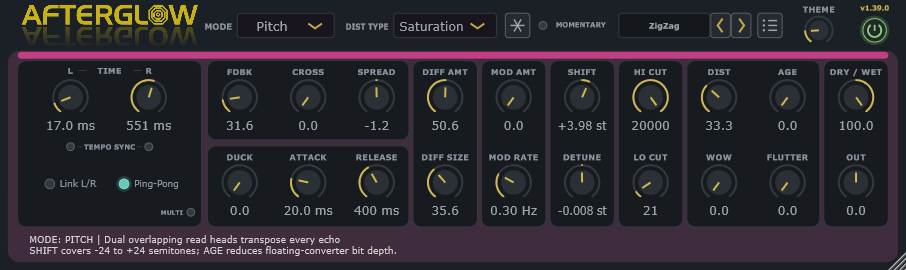

# Afterglow 1.40.0

Afterglow is a stereo VST3 delay by sl23 for the Dead Channel Audio plugin suite. Version 1.40.0 begins the Delay Style routing rebuild. Converted presets now retain their original Single, Dual, Ratio, Ping-Pong or Quad identity, while Ping-Pong uses a direct Left-to-Right transfer and applies Feedback once per complete stereo circuit.

Credits: Many thanks to Artvera for the logo.

## Build and installation

Project root: `_Projects\Afterglow`, beside the shared `_Projects\_Tools` folder.

1. Save the current PolyHostInterface project because the build closes PHI automatically.
2. Double-click `- Build.bat`.
3. Wait until `BUILD SUMMARY` shows all four checks as `PASS`.
4. Use the portable Windows x64 plugin at `dist\Afterglow.vst3`.
5. If the build fails, send the newly generated `Results.log`.

The build uses JUCE 9.0.4, CMake 4.4.2 and Visual Studio Community 2026 x64 from the existing shared tool folders. It does not install the plugin automatically.

## Current delay modes

### Digital

Uses dual read-head crossfades when the delay time changes. This avoids intentional varispeed pitch sweeps and keeps ordinary timing changes clean. Mod Amount and Rate drive a smoothly rounded triangle LFO; linked channels share its motion, while independent channels are phase-offset. At flanger-length times, only the part that would cross a 0.25 ms safety floor is moved forward, retaining the complete modulation depth without collapsing into a near-zero feedback loop. Age reduces the floating-converter resolution from pristine to deliberately coarse without adding analogue drift or wear.

### Tape I

Uses a continuously moving read head, delay-time-dependent drift, two-stage high-frequency head loss and soft tape saturation. Age progressively increases bandwidth wear and compression.

### Tape II

Uses a separate inertia-based transport that continuously accelerates, glides and decelerates towards a changed Time setting. Its bounded varispeed avoids an instantaneous or mechanically linear pitch ramp, while a warm two-stage head response, subtle inherent wow/flutter and level-compensated asymmetric magnetic colour produce a smoother tape echo. Age increases bandwidth wear and magnetic compression. Stereo and Multi-Tap timing use the same transport model.

### HiFi

Uses continuous varispeed delay movement like a studio reel-to-reel delay, while remaining much brighter and cleaner than Tape I. Gentle inherent saturation and drift distinguish it from Digital; Age adds restrained bandwidth wear and asperity texture.

### Brigade

Models a deliberately dark bucket-brigade delay with two-stage, delay-dependent bandwidth loss, continuous clock movement, companding, progressively coarser resolution, signal-tracking noise and stronger controlled saturation.

### Ghost

Uses a continuously moving analogue-style delay feeding a quadrature frequency shifter. Shift moves both channels from -1000 to +1000 Hz with fine resolution around zero; Detune adds 0-100 Hz of left/right separation around that central value. The spectral displacement accumulates naturally through the feedback loop, including Multi-Tap, while Age progressively darkens and saturates the shifted repeats.

### Pitch

Uses two overlapping, windowed read heads per channel to transpose each delayed return from -24 to +24 semitones. Detune offsets the left and right shifts around that central value. Age reduces the floating-converter resolution. The result enters the feedback loop, so the selected interval accumulates across successive repeats rather than acting as a one-off tonal treatment.

### Pitch Rev

Uses two overlapping reversed grains per channel and places their transposed result inside the feedback loop. Each Time control sets that channel's splice length; Shift changes reverse playback pitch and Detune offsets the channels around it. Below 40 ms, the overlap progressively focuses around each micro-splice so settings such as 7.0/4.3 ms remain distinctly granular without creating hard boundaries. Age reduces the floating-converter resolution. Above-unity regeneration includes a small fixed loss proportional to transposition distance, allowing large shifts to move out of band and decay instead of locking the saturator into a permanent sub-bass tone. The result is a reversed, pitch-moving wash rather than Pitch mode played backwards after the delay.

### LoFi

Uses a deliberately worn-tape path with permanent two-stage bandwidth loss, level instability, asymmetric odd/even harmonic colour, coarse texture and signal-tracking hiss. Stereo-decorrelated random drift, inherent wow/flutter and scrape motion remain active before any controls are raised, while Mod Amount, Mod Rate and Age intensify the instability. Its nonlinear stage is level-normalised so the character no longer masquerades as a longer or louder feedback decay.

### Crystal

Uses a pristine bright digital path with smoothly rounded triangle-wave modulation and a nearly colourless soft-knee feedback limiter. Low Cut, High Cut and a steep Age-controlled low-pass filter colour the audible return outside the feedback loop, so the repeats retain their brightness instead of becoming progressively darker on every circulation.

### Phaser

Places a selectable 2/4/6/8/10/12-stage stereo phaser inside the regenerating delay path. Mod Amount controls notch-sweep depth, Mod Rate controls speed, RES controls internal resonance and STAGE changes the notch count. AGE remains visible but disabled. All twelve stages stay warmed and stage changes crossfade smoothly instead of exposing cold filter state or switching abruptly.

### Pitch Lush

Combines a pitch-shifted delay voice with a second stereo-detuned voice at the same overall delay time. Shift sets the main transposition, Detune separates the channels in both voices, and P MIX blends continuously from the detuned voice at 0% to the shifted voice at 100%. The combined result enters feedback so shimmer-like pitch structures build across repeats.

### Chromatic

Uses its own continuous tape path with a cleaner transport, brighter two-stage head response, restrained inherent wow/flutter and higher feedback headroom than Tape I. Age now moves clearly from open and clean to dark, compressed head wear, while the mode deliberately omits tape-noise and splice-style artefacts.

### Analogue

Uses a brighter, quieter bucket-brigade path with roughly twice Brigade's working bandwidth, finer companding resolution, restrained clock motion and approximately half its noise. Age progressively narrows the bandwidth, raises the clock texture and drives a thicker asymmetric analogue saturation stage.

### Chaotic

Uses independently wandering delay intervals and pitch ratios for the two channels. The motion is smoothly interpolated rather than stepped, remains inside bounded delay and pitch ranges, and regenerates through the feedback path to form evolving forward patterns.

### Pure Reverse

Uses overlapping reverse grains at the original pitch. Each Time control sets the grain length, while Feedback layers the reversed material without introducing the transposition of Pitch Rev.

### Chaotic Rev

Combines overlapping reverse grains with the independently wandering delay and pitch motion of Chaotic. Feedback produces tumbling, irregular reverse layers while all motion and return levels remain bounded.

### Forward Rev

Pairs a clear forward audible repeat with a separate reverse-grain regeneration path. The reverse feedback path has independent filtering and diffusion state, allowing a clouded reverse tail without smearing the first forward echo.

## Controls

- Independent Left and Right delay times from 1 to 2000 ms with 0.1 ms precision below 100 ms.
- The `MULTI` LED in the Timing panel switches between the normal stereo timing page and a compact four-tap page without discarding either page's settings.
- Each of the four taps has its own Time, bipolar Pan, Volume and numbered On LED. The tap number is drawn inside the switch itself, removing the redundant row-number column. A single global `SYNC` LED changes all four Time knobs between their independently stored millisecond values and musical divisions, which keeps rhythmic patterns coherent while retaining per-tap timing.
- Multi-tap page changes, tap enable changes, time movement, pan and volume are smoothed. Active tap levels use fixed RMS normalisation, preventing a four-tap pattern from creating an uncontrolled level jump without introducing envelope pumping.
- Dedicated Left and Right Tempo Sync LEDs let either channel use milliseconds or musical note divisions independently. Straight, dotted and triplet choices are available through 1/64 and are ordered shortest-to-longest.
- Link L/R makes the disabled Right Time knob follow the complete Left timing state—value and free/synced interpretation—without overwriting Right's stored millisecond, note-division or sync setting. Unlinking restores all three Right settings.
- Switching either Tempo Sync LED never converts or overwrites that channel's stored millisecond and note values.
- The Mode and Distortion Type choices use readable title case and are shown alphabetically while retaining their direct parameter identities. Both popups always open downwards with the first item at the top, use the selectors' text colour, a restrained dark hover rectangle inset from the two-pixel coloured border, and retain the current mode colour around that border. Wheel handling still advances exactly one item per physical movement from the first movement.
- The two Tempo Sync LEDs illuminate green, Link L/R illuminates amber and Ping-Pong retains its teal status colour.
- Feedback runs from 0% to 200%. The displayed 0-80% uses a direct traditional mapping. From 80-97%, a smooth transition reaches the established square-root response used by the matched high-feedback reference; 97-100% retains that response through exact unity. The temporary 60-90% boost has been removed because it was compensating for the former double attenuation in Ping-Pong. The displayed 100-200% range continues linearly to 100-125% internal regeneration. Pitch Rev alone restores a small, fixed transposition-dependent loop loss above unity so extreme shifts can leave the audible band instead of forming a permanent saturator tone; no envelope follower or pumping gain is used. Per-mode saturation and static output-only safety keep extreme output bounded without compressor pumping. Cross Feedback remains continuously variable; at 100% Cross, each repeat feeds the opposite channel while retaining normal stereo input routing.
- The compact snowflake button smoothly excludes new input from the delay and moves the existing feedback loop to unity while leaving the dry signal, selected mode, timing, modulation and stored FDBK value untouched. Its neighbouring LED selects `MOMENTARY`—the default, active only while held—or `TOGGLE`, which latches and releases Freeze on successive clicks.
- Ping-Pong is a dedicated smoothed topology: it sums the input safely into the Left delay, transfers the processed Left output directly into the Right delay, then applies FDBK only when the Right output returns to Left. A complete stereo circuit therefore receives one Feedback multiplication rather than the former `feedback × feedback` loss. Turning Ping-Pong off restores the Cross knob's normal stereo matrix without a hard switch.
- Bipolar Spread from -100% to +100% controls delayed-signal width without changing the Cross-feedback rhythm: 0% centres the repeats, +100% gives full width and negative values reverse their left/right placement. It has a centre detent.
- Duck from 0% to 100% reduces only the audible wet return while new input is present. The dry signal and internal feedback regeneration remain untouched, so repeats recover naturally instead of being erased from the delay loop.
- Duck Attack ranges from 1 to 500 ms and Duck Release from 20 to 3000 ms. A stereo-linked peak envelope prevents the delayed image from shifting sideways while it ducks.
- Diffusion Amount from 0% to 100% blends a four-stage stereo allpass network into the repeat path. Diffusion Size from 0% to 100% scales the network from a compact blur to a larger cloud. Because it precedes feedback, the softening accumulates naturally across echoes.
- Mod Amount from 0% to 100% adds up to 35 ms of smooth delay-time movement, calibrated from the Shuffler harmonic excursion. Digital uses a rounded triangle: linked channels move together and independent channels are offset by 90 degrees. LoFi substitutes stereo-decorrelated random drift, Crystal uses its own smoothed triangle path, and Phaser uses the same 0-100% control range for its stereo notch sweep. Mod Rate ranges from 0.02 to 10 Hz. At extremely short Digital times the complete depth is retained by moving only the otherwise-negative portion of the sweep forward from a 0.25 ms safety floor.
- In Pitch, Pitch Rev and Pitch Lush modes, bipolar Shift selects -24.00 to +24.00 semitones. Bipolar Detune selects a -1.000 to +1.000-semitone total stereo difference in 0.001-semitone (0.1-cent) steps: Left receives half below the Shift value and Right half above it; a negative Detune reverses that relationship. One semitone equals 100 cents, so this Detune range is exactly -100 to +100 cents.
- Shift and Detune have centre detents in the pitch modes. In Ghost the panel attaches to separate Hertz parameters: bipolar Shift covers -1000 to +1000 Hz and unipolar Detune covers 0-100 Hz. In Phaser the same panel becomes active RES and stepped STAGE controls; elsewhere it is visibly unavailable.
- 0-80% Feedback maps directly to loop regeneration. A smooth high-feedback calibration reaches the established square-root response at 97%; mode-specific filtering and saturation colour the repeats without selecting a different Feedback-length curve. Pitch Rev's fixed transposition loss begins only above 100%.
- Per-mode saturation and static output-only compensation keep dense tails controlled without envelope detection, compressor pumping or time-varying gain inside the feedback loop.
- Dry/Wet balance and Output gain.
- Dry/Wet has a 50% centre detent; Output has a 0 dB centre detent. Their indicator arcs grow outwards from their centre positions.
- Double-clicking any audio knob restores that parameter's value from the current preset or host-saved state. Saving or Save As establishes the new reset values immediately. Theme remains a global interface setting and keeps its independent reset.
- Low Cut and High Cut applied to every echo, including the first.
- DIST sets the input-distortion amount. Distortion Type contains 15 choices: `SOFT CLIP`, the established dense tanh circuit; `SATURATION`, a more open arctangent curve; `TUBE`, an asymmetric rounded valve-like curve; `RECTIFY`, an octave-rich full-wave fold; `CRACKLE`, signal-responsive broken-contact pops; `LIGHTNING`, sharp clipping charged with signal-tracked noise; `AMP`, cascaded asymmetric amp-style stages; `BUMPY`, frequency-shaped nonlinear ripples; `ASYM`, contrasting positive and negative transfer curves; `RAZOR`, bright upper-mid pre-emphasis and ridged shaping; `PIXELATED`, progressively coarser sample hold and bit reduction; `COMB`, a short damped resonant circuit; `STRESSED`, compressed asymmetric folding; `SAMURAI`, dead-zone slicing with a metallic edge; and `FRESH`, high-band excitation over cleaner saturation. Type changes crossfade smoothly, stateful choices use bounded preallocated state and DC removal where required, and input distortion never re-processes recirculating repeats.
- Wow and Flutter add user-controlled movement in every mode. Tape I, Tape II, Chromatic, Brigade, Analogue, HiFi and LoFi retain mode-specific movement so selecting the mode alone changes its character.
- Age reduces floating-converter bit depth in Digital, Pitch and Pitch Rev; deepens head loss and saturation in Tape I; adds head wear and magnetic compression in Tape II; controls head wear in Chromatic, bandwidth/compander texture in Brigade, quieter bucket-brigade wear in Analogue, restrained wear and asperity in HiFi, spectral wear in Ghost, instability in LoFi, and steep output low-pass filtering in Crystal. It remains disabled only in Phaser. Pitch Lush replaces this panel position with its dedicated `P MIX` parameter.
- The fixed two-line contextual information area now occupies only the lower-left 683 design pixels inside the coloured surround. The lower-right area beneath the last two panels remains clear for future buttons.
- The obsolete outer help area has been removed, reducing the design height from 326 to 276 pixels. The resulting eight-pixel bottom margin matches the coloured surround's side margins.
- Rotary value fields retain their normal appearance, while clicking one opens an 18-pixel-high editor that displays the complete typed value without clipping its lower edge.
- Top-right Power indicator uses a clearer green illumination while processing is active and remains unlit while bypassed. Host bypass automation remains conventional, uses a smoothed dry/processed transition and leaves the delay engine running.
- FDBK, CROSS and SPREAD share a shallow upper panel aligned with Hi Cut.
- DUCK, ATTACK and RELEASE share a matching lower panel aligned with Lo Cut.
- DIFF AMT–DIFF SIZE and MOD AMT–MOD RATE each occupy a dedicated vertical panel.
- Dry/Wet–Output is the rightmost panel because it is last in the audible signal chain.
- The coloured frame has equal left and right insets around the control panels.
- The complete upper and lower control rows retain the enlarged separation between Feedback and Ducking. The `LED — TEMPO SYNC — LED` row sits directly beneath the Left and Right Time knobs, with Link L/R and Ping-Pong on the lower timing-switch row.
- The former purple panel background follows the selected mode. Tape I uses RGB `61, 100, 6`; Brigade `100, 35, 70`; HiFi `193, 69, 33`; Ghost `130, 67, 110`; and Forward Rev `89, 71, 107`. The remaining modes retain their established colours.
- Every rotary indicator and combo-box arrow uses a restrained warm yellow, while LEDs retain their dedicated status colours.
- The Link L/R and Ping-Pong captions use the same muted colour as the Theme caption for a quieter, consistent switch row.
- The small Theme knob beside Power has no numerical readout. Turning it clockwise fades only the large surround from charcoal into the selected mode colour. The seven-pixel strip is always painted above it at the selected mode's exact colour and full opacity—its colour and alpha never change. At maximum Theme the surround reaches that same colour, so the unchanged strip naturally blends into it.
- The strip has a two-pixel clear gap above the control panels. The surround extends ten pixels beyond the panels at both sides, matching the panels' ten-pixel top inset.
- Artvera's transparent 701×167 Afterglow logo remains at the upper left. The compact `v1.40.0` label sits directly above the Power button, freeing the middle of the header for preset navigation.
- Mode, Dist Type and the compact Freeze controls sit further left. A rounded current-preset field with enlarged text is followed by adjacent, equal-sized previous/next buttons before the unchanged list-icon preset-browser button; Theme and Power retain their positions. The arrows use the same stroked yellow chevron as the selectors, rotated left and right. Wheel movement over the field loads one preset, while clicking it opens a two-pixel mode-coloured popup using the same font size as the selectors and at most 20 visible, scrollable rows.
- Theme and Power use matching 30×30 controls on the same lower header baseline. The Theme label is two pixels lower for better visual alignment without moving either control.
- Compact rotary styling shared with SV-Drummer.
- Dragging the bottom-right corner scales the complete interface from 75% to 200% at a fixed aspect ratio.
- The last scale and Theme setting are stored globally in `Root\Afterglow\Settings\Settings.ini`, outside audio presets and host project state.
- The list-icon button hides the inner control panels and contextual-help strip, then opens a taller browser inside the existing coloured surround without changing the GUI height. The left 30% presents the folders beneath `Root\Afterglow\Presets` without wasting a row on the parent `Presets` folder itself. The preset area uses two name columns beside a vertical column of three matching 26x26 action buttons.
- Double-click or Return loads a preset. The header arrows or wheel-scrolling the preset field move through the current preset's folder in natural filename order and wrap at both ends. The floppy-disk icon overwrites the current preset, or invokes Save As when no preset has yet been saved or loaded; the floppy-disk-with-pencil icon always creates a new file or copy; and the folder icon opens the selected preset folder. Afterglow presets use the `.agpreset` extension and the current state schema only. The active preset reference survives editor and host-project reopening but is stripped from preset files; Theme, GUI scale and browser state remain global rather than becoming preset data.

## 1.32.0 First public release

- Promoted Afterglow to its first public release while retaining saved-state schema 32 and every existing parameter ID and mode index.
- Set Tape I to RGB `61, 100, 6`, Brigade to `100, 35, 70`, HiFi to `193, 69, 33`, Ghost to `130, 67, 110` and Forward Rev to `89, 71, 107`.
- Corrected the visible `Foreward Rev` spelling to `Forward Rev` without changing its DSP or parameter identity.

## 0.28.0 Preset browser and icon refinement

- Added a recursive folder tree and preset list within the existing coloured panel, preserving the normal interface height and header.
- Added double-click and Return loading, instant Save of the current preset and Save As for new presets and copies.
- Replaced the wide FREEZE text button with a compact, less-rounded snowflake icon while retaining Momentary and Toggle behaviour.
- Darkened Crystal's mode colour to improve help-text contrast at full Theme.
- Advanced the state schema to version 32 and updated all project metadata to 0.28.0.

## 0.27.0 Freeze and compact help layout

- Added a smoothed Freeze that blocks new delay input and sustains the existing loop at unity without overwriting FDBK or changing the dry path.
- Added default Momentary operation and an LED selector for latched Toggle operation.
- Moved contextual help into the lower-left of the coloured surround, reserved the lower-right for future controls and reduced the complete GUI height so its bottom outer margin matches the sides.
- Enlarged only the active text-entry area for rotary values while retaining the existing normal knob geometry.
- Advanced the state schema to version 31 and updated all project metadata to 0.27.0.

## 0.26.2 Controlled feedback-length correction

- Removed the 0.26.1 curve that placed 95.5% at approximately 99.4% internal retention and could create a tail lasting several minutes.
- Replaced it with a restrained global decay correction: 95.5% now maps to approximately 97.7% and 97% to approximately 98.5% internal retention.
- Kept 0-80%, the exact 100% unity point, the 100-200% regenerative range and all per-mode sound processing unchanged.
- Advanced the state schema to version 30 and updated all project metadata to 0.26.2.

## 0.26.1 Global feedback-length calibration

- Kept each delay mode's existing feedback sound unchanged. Modes still determine colour, filtering, modulation, saturation and stereo behaviour, but no mode selects a separate feedback-length curve.
- Left 0-80% Feedback completely unchanged.
- Added one smooth global 80-100% calibration derived from the reported matched test.
- The new mapping is continuous at 80% and 100%, reaches approximately 95% internal retention at a displayed 90%, 99.2% at 95% and 99.8% at 97%, and still reaches exactly unity at 100%.
- Left the restored 100-200% regenerative range, per-mode processing and output-only safety unchanged.
- Advanced the state schema to version 29 and updated all project metadata to 0.26.1.

## 0.26.0 Expressive feedback restoration

- Removed the 0.25.0 shared feedback conditioner. Its second saturation stage, bass restraint and 108% internal-gain ceiling made high feedback progressively flatter and less responsive after every circulation.
- Restored the direct 0-100% response and the complete 100-125% internal regenerative range across the displayed 0-200% control.
- Removed feedback-dependent wet attenuation throughout the ordinary 0-100% range. Raising Feedback no longer makes the complete delayed signal quieter.
- Retained fixed, non-pumping output safety outside the feedback loop. Only gain above the 100% self-oscillation threshold receives gradual output compensation, leaving repeat length, nonlinear mode colour and delay-time pitch movement intact inside the loop.
- Advanced the state schema to version 28 and updated all project metadata to 0.26.0.

The Korg Electribe EA-1 reference behaves differently from a conventional independent Feedback knob: its Delay Depth control raises both delayed-signal level and feedback. Afterglow continues to keep FDBK and Dry/Wet independent so normal delay operation remains predictable; recreating the EA-1 performance uses high FDBK together with moving Time in Tape I or Tape II.

## 0.25.0 Controlled regeneration, mode names and linked Sync indication

- Reworked 100-200% Feedback as a deliberately controlled regenerative region. The displayed range now maps progressively from 100% to a maximum 108% internal gain instead of reaching 125%.
- Added a fixed-cost feedback conditioner shared by every mode and both timing pages: permanent DC/subsonic blocking, a gradual low-bass shelf above 100% and a smooth in-loop ceiling that becomes stronger as regeneration rises.
- Preserved the direct, traditional 0-100% response introduced in 0.24.0.
- Renamed the visible modes to `Tape I`, `Brigade`, `Chromatic`, `Chaotic`, `Pitch Lush`, `Pitch Rev`, `Chaotic Rev` and `Forward Rev`, retaining the same DSP algorithms and direct mode indices.
- Darkened the Mode and Distortion Type popup hover rectangle.
- While Link L/R is active, the disabled Right Tempo Sync LED now follows the effective Left Sync state and is visibly dimmed. Unlinking restores the separately stored Right Sync state.
- Advanced the state schema to version 27 and updated all project metadata to 0.25.0.

## 0.24.0 Traditional feedback, Tape II and narrower layout

- Replaced the hidden sub-100% feedback taper with direct percentage-to-loop regeneration. A displayed 90% now supplies 90% regeneration before mode colour, while 100-200% retains the bounded driven mapping.
- Added `Tape II` as an eighteenth delay mode with a dedicated acceleration/damping transport model, bounded varispeed, two-stage head response, inherent motion and level-compensated asymmetric magnetic saturation in Stereo and Multi-Tap timing.
- Changed visible Mode and Distortion Type item names from all capitals to readable title case while preserving established abbreviations and unchanged parameter IDs.
- Reduced rotary width from 66 to 60 pixels, the regular control-centre grid from 78 to 70 pixels and the design width from 1004 to 926 pixels. The Timing panel retains its space for Multi-Tap, while every other panel is reduced around the evenly spaced controls.
- Advanced the prototype state schema to version 26 without backward-compatibility code.

## 0.23.0 Reverse/chaos modes and compact popup/layout pass

- Added `Chaos`, `Pure Reverse`, `Reverse Chaos` and `Reverse Forward` as four distinct delay algorithms, including Stereo and Multi-Tap rendering, smoothed mode changes, dedicated grain/modulation state and bounded feedback returns.
- Sorted the visible Mode and Distortion Type menus alphabetically without changing their parameter identities.
- Made both menus open downwards from the selector with the first entry at the top, and inset/lightened the hover highlight so it no longer covers the coloured popup border.
- Moved the four Multi-Tap row numbers into the On LEDs and removed the separate number column.
- Narrowed every non-Timing panel and the complete interface while retaining a regular 78-pixel control-centre grid. The Timing panel remains unchanged for the four-tap layout.
- Changed the Power illumination to a clearer green.
- Expanded the diffusion storage for the independent Reverse Forward audible and feedback paths while keeping all real-time state preallocated.
- Advanced the prototype state schema to version 25 without backward-compatibility code.

## 0.22.0 Complete distortion bank and Multi-Tap spacing

- Added `ASYM`, `RAZOR`, `PIXELATED`, `COMB`, `STRESSED`, `SAMURAI` and `FRESH`, completing the current 15-choice Distortion Type bank in one release.
- Each new circuit has a distinct transfer or time-domain design, bounded output and preallocated per-channel state. Stateful DC-generating shapes use dedicated DC blockers.
- Distortion switching now crossfades directly between the old and new selections for 20 ms. Once settled, only the selected algorithm runs; menu size therefore does not multiply steady-state distortion processing.
- Moved the Multi-Tap `MULTI` and global `SYNC` controls to the bottom of the Timing panel, raised the four tap rows and increased both row and column spacing without enlarging the panel.
- Advanced the prototype state schema to version 24 without backward-compatibility code.

## 0.21.0 Multi-Tap, Bumpy and interface colours

- Added a four-tap page inside the existing Timing panel, selected by a `MULTI` LED without enlarging the interface.
- Added independent Time, bipolar Pan, Volume and On controls for all four taps, plus one global Multi-Tap Sync switch. Free-time and note-division values remain stored separately.
- Added click-resistant page, tap-enable, time, pan and level transitions, fixed RMS tap normalisation and mode-aware tap character while preserving the existing Feedback, Cross, Spread, Ducking, Diffusion and filtering path.
- Added `BUMPY` as the eighth Distortion Type, using frequency-shaped nonlinear ripples for an uneven character with bounded output, DC removal and the existing click-resistant type transition.
- Renamed the visible `Analog` mode to British English `Analogue` without retaining an obsolete alias.
- Changed the Power light to a slightly yellow-green colour and matched the Link L/R and Ping-Pong caption colour to Theme.
- Advanced the prototype state schema to version 23 without backward-compatibility code.

## 0.20.0 Analogue, Amp and Chrome Tape Age

- Added Analogue as a thirteenth delay algorithm with a brighter, quieter BBD-inspired path, finer companding texture, restrained clock motion and thicker asymmetric saturation.
- Added `AMP` as the seventh Distortion Type with cascaded asymmetric Class-A-style stages, amp-like high-frequency roll-off, DC removal and the existing click-resistant type transition.
- Made Chrome Tape AGE substantially more audible through a wider head-bandwidth and compression range while preserving its cleaner transport character.
- Moved `v0.20.0` to approximately 30 pixels from the visible logo edge.
- Advanced the prototype state schema to version 22 without backward-compatibility code.

## 0.19.0 Chrome Tape, Lightning and naming cleanup

- Renamed the active RichPitch mode to `LushPitch` and the active Crackly distortion choice to `Crackle`, without obsolete aliases or conversion code.
- Added Chrome Tape as a twelfth delay algorithm with a dedicated cleaner tape path, brighter head filtering, restrained inherent motion and controlled Age-dependent saturation.
- Added `LIGHTNING` as the sixth Distortion Type, combining bounded hard clipping with signal-tracked white noise, DC removal and the existing click-resistant type transition.
- Added the current `v0.19.0` number immediately to the right of the logo and moved the Mode/Dist Type selectors right to preserve clear spacing.
- Advanced the prototype state schema to version 21 without backward-compatibility code.

## 0.18.0 Phaser controls, RichPitch and Crackly

- Renamed the visible `Phaser DDL` mode to `Phaser`.
- Restored a visible but disabled AGE control in Phaser and changed the Pitch panel dynamically to dedicated `RES` and stepped `STAGE` controls.
- Added all selectable Phaser stage counts from 2 through 12 in two-stage increments, with a short crossfade between continuously warmed stage outputs.
- Added RichPitch as an eleventh delay algorithm, combining separate shifted and stereo-detuned voices through a dedicated P MIX parameter inside the feedback path.
- Added `CRACKLY` as the fifth Distortion Type, using deterministic signal-responsive burst events, compact saturation, DC removal and the existing click-resistant type transition.
- Moved only the Theme label down two pixels and advanced the prototype state schema without compatibility code.

## 0.17.0 Crystal, Phaser DDL, Rectify and logo

- Renamed Quartz to Crystal throughout the active parameter list, interface, contextual help and documentation.
- Added Phaser DDL as a genuine tenth delay algorithm with twelve feedback-loop all-pass stages, quadrature stereo modulation and Age repurposed visibly as phaser resonance.
- Added `RECTIFY` as the fourth Distortion Type with octave-rich full-wave folding, dedicated DC removal, static output compensation and click-resistant type switching.
- Embedded Artvera's supplied transparent Afterglow logo and replaced the drawn header title without altering or recolouring the artwork.
- Matched the Theme knob to the Power button's 30×30 size, aligned both controls and moved them down while leaving the Theme label fixed.
- Changed the Mode and Distortion Type arrows to the knob yellow and gave both popup menus a two-pixel border in the current mode colour.
- Added an indigo Phaser DDL theme colour and advanced the prototype state schema without compatibility code.

## 0.16.0 Quartz, Tube and timing LED colours

- Added Quartz as a genuine ninth delay algorithm with a pristine bright path, smoothed triangle modulation, a nearly colourless feedback limiter and a separate diffusion state.
- Kept Quartz's Low Cut, High Cut and steep Age filtering outside its feedback loop, so the audible tone can be shaped without progressively dulling each repeat.
- Added `TUBE` as the third Distortion Type with an asymmetric biased transfer curve, rounded compression, static level compensation and click-resistant switching.
- Changed both Tempo Sync LEDs to green and Link L/R to amber while retaining Ping-Pong's existing teal colour.
- Added Quartz's cyan theme colour and updated contextual help for Quartz, Tube, Modulation and Age.
- Advanced the prototype state schema without adding obsolete-state conversion code.

## 0.15.1 Theme, LoFi and feedback correction

- Made the colour strip permanently use the selected mode colour at full opacity; Theme now changes only the surround behind it.
- Moved the two Tempo Sync LEDs and their centred label directly beneath the Time knobs, above the Link/Ping-Pong row.
- Strengthened LoFi's permanent bandwidth wear, chaotic pitch and level motion, hiss, scrape flutter, resolution loss and asymmetric harmonic colour.
- Corrected LoFi's nonlinear level compensation so its identity is no longer mainly an accidental feedback-gain increase.
- Replaced direct percentage-to-loop-gain Feedback mapping with a musical curve: 90% now maps to approximately 78% internal regeneration, 100% remains the sustained threshold, and the displayed 100-200% range drives a bounded 100-125% internal range.
- Added static feedback-position output compensation to control dense tails without pumping.
- Advanced the prototype state schema without adding obsolete-state conversion code.

## 0.15.0 LoFi, Ping-Pong and portable interface settings

- Added LoFi as a genuine eighth algorithm with worn-tape filtering, asymmetric harmonic colour, noise, coarse texture, chaotic low-rate drift and Age-driven scrape flutter.
- Added a smoothed Ping-Pong route that feeds summed input to the Left tap and alternates feedback between channels.
- Replaced the shared Tempo Sync state with independent Left and Right LED controls while preserving each channel's separate millisecond and note values.
- Made Link L/R temporarily apply the complete Left timing state to Right without overwriting any stored Right setting.
- Added fixed-aspect bottom-right GUI resizing from 75% to 200%.
- Added `Root\Afterglow\Settings\Settings.ini` for global GUI scale and Theme persistence, plus an empty `Root\Afterglow\Presets` directory ready for preset work.
- Moved Theme out of the audio parameter/preset state and made the foreground colour strip blend exactly into the full-colour surround at maximum.
- Advanced the prototype state schema without adding obsolete-state conversion code.

## 0.14.0 RevPitch, Saturation and theme spacing

- Added RevPitch as a genuine seventh algorithm with two complementary Hann-windowed reverse grains per channel.
- Made each Time control set its RevPitch splice length and reused the smoothed Shift and Detune ratios for reverse playback pitch.
- Placed RevPitch inside feedback with its own controlled saturation and retained the click-resistant 20 ms algorithm transition.
- Added `SATURATION` as a distinct second Distortion Type using an open arctangent transfer curve, gentler input gain and separate static output compensation.
- Reversed the Theme direction so maximum restores the full mode-coloured surround and minimum produces the charcoal treatment.
- Removed the Theme value readout, kept the colour strip seven pixels thick and painted it as a foreground accent above the fading surround.
- Added two pixels between the strip and panels, then extended the surround so its left and right panel margins match the new ten-pixel top inset.
- Advanced the prototype state schema without adding obsolete-state conversion code.

## 0.13.0 adjustable Pitch and dual theme treatment

- Added host-automatable bipolar Shift (-12 to +12 semitones) and Detune (-1 to +1 semitone) controls in a dedicated vertical Pitch panel.
- Reworked the Pitch read-head rate per channel so Shift and Detune automation is smoothed without allocations in the audio callback.
- Kept the previous +7-semitone sound as the initial Shift value while allowing an exact unshifted 0-semitone centre.
- Added a saved, host-automatable Theme control that continuously fades the full mode-coloured surround into the supplied dark design with its thin rounded colour strip.
- Changed every rotary indicator to a moderate warm yellow and retained clear disabled-state greying.
- Expanded the fixed interface only by the width of the Pitch panel, preserving equal six-pixel panel insets and keeping Dry/Wet–Output last in the chain.
- Advanced the prototype state schema without adding obsolete-state conversion code.

## 0.12.0 Pitch mode, Distortion Type and spacing

- Added Pitch as a real sixth algorithm with two overlapping windowed read heads per channel.
- Fixed the present Pitch interval at +7 semitones and placed the shifted return inside feedback, so the transposition accumulates on successive echoes.
- Added a saved, host-automatable Distortion Type choice parameter and placed its combo box beside Mode.
- Preserved the existing distortion sound as the first `SOFT CLIP` type and renamed the visible amount control from Drive to DIST.
- Narrowed the Timing panel and complete interface by 18 pixels while retaining equal six-pixel coloured margins at both edges.
- Moved every upper-row knob up three pixels and every lower-row knob down four pixels.
- Advanced the prototype state schema without adding obsolete-state conversion code.

## 0.11.0 diffusion, modulation and visual alignment

- Added smoothed, host-automatable Diffusion Amount and Diffusion Size controls.
- Added a four-stage, independently timed stereo allpass network inside the repeat path, allowing diffusion to build through feedback rather than acting as a final-output blur.
- Added smoothed, host-automatable Mod Amount and Mod Rate controls with quadrature stereo movement across every delay mode.
- Added automatic short-delay depth limiting so strong modulation cannot repeatedly force a read head against its minimum position.
- Added separate vertical Diffusion and Modulation panels while keeping Dry/Wet–Output at the far right.
- Corrected Timing-switch alignment by centring each complete LED-and-label group, not merely its component bounds.
- Expanded the interface to preserve the existing six-pixel coloured margin at both sides.

## 0.10.0 wet-return ducking and stacked panels

- Added smoothed, host-automatable Duck, Attack and Release controls.
- Added a stereo-linked input envelope that turns down the audible wet return without changing the dry path or the audio recirculating inside the feedback loop.
- Restored FDBK, CROSS and SPREAD to a single horizontal row in a reduced-height upper panel.
- Added a matching lower Ducking panel containing DUCK, ATTACK and RELEASE.
- Aligned the upper panel with Hi Cut and the lower panel with Lo Cut.
- Moved all upper-row knobs up four pixels, left the lower row in place and centred the two Timing switches beneath their respective knobs.
- Widened the interface only as much as needed to preserve equal six-pixel coloured margins.

## 0.9.0 knob timing and Ghost mode

- Removed both Note combo boxes and made the existing Left and Right Time knobs switch directly between millisecond and musical-note parameters.
- Preserved independent millisecond and note-division values for each channel, including while Link L/R is active.
- Aligned both Time knobs with the upper control row and retained the Tempo Sync LED switch.
- Reflowed FDBK and CROSS onto the upper row with SPREAD centred beneath them.
- Reduced the grouped panel widths and the overall interface width while restoring equal coloured margins at both sides.
- Added Ghost as a real fifth algorithm with continuous delay movement, stereo-opposed frequency shifting, analogue filtering and feedback saturation.
- Added a purple Ghost interface colour and updated the contextual mode description.

## 0.8.0 stereo spread and timing clarity

- Added a smoothed, host-automatable bipolar Spread parameter.
- Applied Spread to the audible wet mid/side image after the feedback path, so width changes do not alter Cross timing or regeneration.
- Grouped FDBK, CROSS and SPREAD in a new three-control panel.
- Moved Dry/Wet–Output to the far right and retained Hi Cut above Lo Cut.
- Removed the `STEREO DELAY / sl23` subtitle and moved Mode into its header position.
- Added mode-coloured panel backgrounds.
- Made the active timing source explicit: millisecond knobs for Free time, Note selectors for Tempo Sync.
- Added same-direction wheel-event suppression to prevent the remaining two-item jumps reported with some mice.

## 0.7.1 audible mode identity and wheel fix

- Corrected the weak mode separation that allowed Tape and HiFi to sound almost identical to Digital when the character controls were low.
- Kept Digital clean and stable as the reference path.
- Gave Tape inherent two-stage head loss, soft saturation and delay-dependent wow/flutter movement before Age adds further wear.
- Made BBD substantially darker, with stronger delay-dependent bandwidth loss, coarser clock resolution, compander texture and controlled saturation.
- Gave HiFi a brighter reel-to-reel response with gentle saturation, restrained filtering and much smaller drift than Tape.
- Replaced JUCE's accumulated combo-box wheel stepping with a deterministic one-item handler, preventing ignored first movements and occasional two-item jumps.
- Kept the existing 20 ms mode crossfade so switching modes remains click resistant.
- Swapped the filter layout so Hi Cut is above Lo Cut.

## 0.5.0 timing and feedback changes

- Added a host-automatable Link L/R switch.
- Linked time is enforced inside the processor, not only represented by the interface.
- Right Time and Right Note visibly follow their left counterparts while linked, and the right controls are disabled.
- Reworked Feedback as a clear 0-200% control.
- Each delayed return is fed back into the delay input to create the next echo.
- Low Cut, High Cut and Tape Age remain inside the repeat path, so their effect accumulates naturally across echoes.
- Feedback above 100% enters self-oscillation instead of being blocked by the previous 95% safety ceiling.
- Added high-headroom soft limiting inside the feedback loop to prevent numerical runaway while preserving regenerative behaviour.

## 0.5.1 interface and level refinements

- Converted Cross, Dry/Wet, Drive, Age, Wow and Flutter from 0-1 displays to 0-100% displays.
- Added a smooth, memoryless ceiling to the audible wet return and static compensation above 100% Feedback.
- Avoided envelope followers and automatic compressors, so the protection cannot pump.
- Added centre detents and centre-origin indicator arcs to Dry/Wet and Output.
- Made the disabled Right Time knob itself visibly grey when Link L/R is enabled.
- Grouped Left Time, Right Time, both Note selectors, Link L/R and Tempo Sync inside a dedicated Timing panel.

## 0.5.2 compact controls and bypass

- Reduced both Timing note-selector widths and narrowed the complete Timing panel.
- Replaced checkbox presentation for Link L/R and Tempo Sync with compact LED switches.
- Added a power-style Bypass control at the top-right of the interface without a text box.
- Made Bypass host-automatable and saved as part of the current prototype state.
- Added a 20 ms bypass crossfade so switching cannot click; internal delay processing and tails continue while the dry signal is passing through.
- Made double-click reset Dry/Wet to its 50% centre.

## 0.5.3 timing-panel polish

- Replaced the Bypass graphic with a centred, conventional power symbol while preserving the subtle active glow.
- Removed the redundant `TIMING`, `LEFT TIME`, `RIGHT TIME`, `LEFT NOTE` and `RIGHT NOTE` labels.
- Added compact line-and-dot `TIME` and `NOTE` group dividers.
- Moved the timing controls upward, reduced the panel height and made its left and right margins symmetrical.
- Enabled mouse-wheel changes on Mode and both Note selectors.
- Added dotted and triplet 1/32 note divisions.

## 0.6.0 BBD mode

- Added BBD as a genuine third delay algorithm rather than a renamed Tape setting.
- Added continuous BBD delay-time movement, so live time changes produce pitch movement instead of Digital mode's read-head crossfade.
- Added delay- and Age-dependent BBD bandwidth, companding, clock quantisation and low-level signal-tracking noise.
- Added independent BBD filter memory and feedback saturation, with a 20 ms click-resistant crossfade between all three modes.
- Enabled Age in both Tape and BBD modes while retaining Digital mode's clean path.
- Moved all Timing controls down four pixels, then moved the Note heading and selectors down four additional pixels.
- Replaced the dot-ended headings with `L — TIME — R` and `L — NOTE — R`; each channel letter is centred over its corresponding control.
- Increased the Timing panel height enough to preserve comfortable lower padding.

## 0.7.0 HiFi mode and grouped interface

- Added straight, dotted and triplet 1/64 Tempo Sync values.
- Reworked Link L/R so the processor uses the left settings and the disabled right controls mirror them visually without changing the stored Right Time or Right Note parameters.
- Reduced the gap between the Note selectors from 24 to 12 pixels, moved the right timing column left by 12 pixels and narrowed the Timing panel by the same amount.
- Added separate vertical panels for Dry/Wet–Output and Lo Cut–Hi Cut, plus a two-by-two panel for Drive, Age, Wow and Flutter.
- Shortened the visible labels to `FDBK`, `LO CUT`, `HI CUT` and `OUT`.
- Inverted the top-right indicator so its glow means Power is on rather than Bypass is on, without reversing the host bypass parameter.
- Added HiFi as a fourth delay mode with bright, continuous studio-tape movement, restrained Age-controlled asperity texture and gentler feedback saturation.
- Extended the 20 ms click-resistant mode transition across Digital, Tape, BBD and HiFi.

## 0.4.0 foundation changes

- Removed all compatibility and migration code from earlier prototypes.
- Replaced temporary parameter IDs with clean current IDs: `mode`, `drive`, `age`, `wow` and `flutter`.
- Replaced the oversized integer Mode placeholder with an actual Digital/Tape choice parameter.
- Added explicit matched mono and stereo bus validation.
- Cached parameter pointers instead of repeatedly looking them up during processing.
- Added click-resistant smoothing for Feedback, Cross, Dry/Wet, Output, Drive, modulation depth and filter coefficients.
- Added finite-value checks around input, feedback memory and output.
- Reworked Drive so its saturation is unmistakable across ordinary input levels without placing it in the feedback path.
- Increased delay memory to eight seconds for slow tempo-synchronised divisions.
- Added a calculated host tail length instead of the old fixed eight-second report.
- Avoided running modulation oscillators and inactive delay-mode processing when they are not needed.
- Kept all memory allocation outside the audio-processing callback.

## Saved-state compatibility policy

Version 1.32.0 established schema 32 as Afterglow's first public saved-state and preset compatibility baseline. Version 1.33.0 introduced schema 33 because Ghost gained two saved parameters. Version 1.40.0 introduces schema 34 and one internal Delay Style choice. Schema 32/33 states receive only the missing public parameters; existing Link, Ping-Pong and Multi-Tap values infer Single, Dual, Ping-Pong or Quad. Ratio requires reconversion because earlier files discarded that identity.

No pre-public converter, legacy parameter alias or general compatibility framework has been restored. Only the two published schemas are accepted by 1.40.0.

## Suggested 1.40.0 test

1. Run `- Build.bat` and confirm the heading reports 1.40.0 and all four checks pass, including the logo requirement.
2. Load a fresh Afterglow 1.40.0 instance in PHI.
3. With both Tempo Sync LEDs off, confirm both Time knobs display milliseconds and respond normally.
4. Set distinct Left and Right millisecond values and remember them.
5. Turn only Left Tempo Sync on and confirm Left shows note values while Right remains in milliseconds; then test the inverse state.
6. Turn both synced knobs through straight, dotted and triplet divisions, including `1/64`, `1/64 D` and `1/64 T`, and confirm every position changes the delay time.
7. Turn each Tempo Sync LED off and confirm that channel's independent millisecond value from step 4 returns unchanged.
8. Turn each LED on again and confirm its note value from step 6 also returns unchanged.
9. In free timing, enable Link L/R and turn the left knob. The right knob should follow visually and become unavailable for separate editing.
10. While linked, change Left Tempo Sync and confirm the disabled Right LED follows the effective Left state while remaining visibly dim. Unlink and confirm Right's prior time, division and sync state all return.
11. Confirm the two Tempo Sync LEDs illuminate green, Link L/R illuminates amber and Ping-Pong retains its teal colour. Confirm Link L/R and Ping-Pong captions match the muted Theme caption colour. Confirm the Tempo Sync LEDs and centred label sit directly beneath their respective Time knobs, above the Link/Ping-Pong row, and that the timing heading shows TIME, NOTE or the mixed Left/Right state accurately.
12. Set Dry/Wet to 100%, Feedback to 0%, and trigger a short drum hit. One delayed echo should be heard.
13. In ordinary Stereo routing, raise Feedback through 25%, 50%, 73.8%, 80%, 90% and 95.5%. Values through 80% remain direct. Then repeat the matched `1/16 T`, 97% reference test: the target remains approximately twelve seconds rather than the previous six, never several minutes, with the same length mapping in every mode apart from its intended tonal decay.
   - Load the regenerated Shuffler preset. Confirm its first echo begins on Left, the processed Left echo transfers to Right without the former FDBK attenuation, and only the completed Right-to-Left circuit receives the displayed 73.8% gain. Compare the supplied recording for alternating level and decay before judging modulation depth.
14. Carefully test 100-200% at a low monitoring level. The control should move decisively from sustained repeats into coloured self-oscillation. The audible output must remain finite and statically bounded without compressor-style pumping.
15. Confirm Cross, Spread, Duck, Diffusion Amount, Diffusion Size, Mod Amount, Dry/Wet, DIST, Age, Wow and Flutter display percentages rather than decimal fractions.
16. Confirm Spread snaps gently to 0%, Dry/Wet to 50% and Output to 0 dB; each bipolar indicator arc must begin at its centre position.
17. Load a preset with non-default Spread and Dry/Wet values, alter both, then double-click each and confirm its saved preset value returns rather than a fixed factory default.
18. With different Left and Right delay times, sweep Spread from +100% through 0% to -100%. The repeats should move from full width to centred to reversed placement without changing their timing or decay.
19. Confirm FDBK, CROSS and SPREAD form one horizontal upper panel aligned with Hi Cut.
20. Confirm DUCK, ATTACK and RELEASE form one horizontal lower panel aligned with Lo Cut.
21. Confirm DIFF AMT–DIFF SIZE and MOD AMT–MOD RATE each occupy a separate vertical panel.
22. Confirm both knob rows retain clear internal padding and visibly comfortable separation between the Feedback and Ducking panels.
23. Confirm Link L/R is centred beneath the Left side, Ping-Pong beneath the Right side, and the separate Tempo Sync row remains balanced directly under the knobs.
24. Confirm the control panels have equal coloured spacing at the left and right edges and Dry/Wet–Output remains the rightmost panel.
25. With Diffusion Amount at 0%, confirm Diffusion Size makes no audible change to the existing delay.
26. Raise Diffusion Amount on a short percussive echo and confirm individual taps soften into a denser tail without a level runaway.
27. Sweep Diffusion Size and confirm it moves smoothly from a compact smear to a larger cloud without clicks or invalid samples.
28. With Mod Amount at 0%, confirm Mod Rate makes no audible change.
29. Raise Mod Amount and sweep Mod Rate from 0.02 to 10 Hz. Confirm the delay moves smoothly in stereo and does not click.
30. Repeat strong modulation with Time near its 1 ms minimum and confirm the read head remains stable rather than flattening against an invalid delay position.
31. Set Cross to 100%, use different Left and Right times and feed one side. Confirm feedback repeats alternate channels while the first tap retains normal stereo input routing. Then enable Ping-Pong and confirm the summed first tap starts on Left and subsequent repeats alternate.
32. With Duck at 0%, confirm the delay level and character are unchanged as Attack and Release move.
33. Set Duck to 100%, play repeated dry transients and confirm the audible echoes move out of the way while each transient is present.
34. Repeat step 33 at a 50% Dry/Wet balance and confirm ducking changes the wet return only; the direct signal must not dip.
35. Raise Feedback, sustain the ducking input, then stop. Confirm the internally regenerating tail returns according to Release instead of having been removed from the feedback loop.
36. Compare short and long Attack and Release values and confirm they alter attenuation and recovery without clicks, invalid samples or runaway output.
37. Scroll one notch at a time over the Mode selector. The first notch must respond and every physical notch must move exactly one item, never two.
38. Set DIST, Age, Wow, Flutter, Diffusion Amount and Mod Amount to 0%, Lo Cut to minimum, Hi Cut to maximum and Dry/Wet to 100%. Compare Digital, Tape I, Tape II, Brigade, HiFi, Ghost, Pitch, Pitch Rev, LoFi, Phaser, Pitch Lush, Chromatic and Analogue; each character mode must be audibly distinct. Crystal should remain intentionally pristine and close to Digital until its dedicated modulation, limiter, filtering or diffusion behaviour is exercised.
39. In Ghost mode, use a sustained note and raise Feedback. The repeat spectrum should keep moving rather than merely changing tone once.
40. Confirm Ghost shifts the two stereo channels in opposing directions and retains a clearly spatial result when Spread is positive.
41. Increase Age in Ghost mode and confirm the repeats become darker and more saturated without unstable level jumps.
42. Change Ghost delay time while audio repeats and confirm continuous analogue-style pitch movement; repeat in Digital mode and confirm its clean crossfade remains intact.
43. Switch modes and confirm the frame changes blue for Digital, green for Tape I, olive-green for Tape II, red for Brigade, orange for HiFi, purple for Ghost, magenta for Pitch, violet for Pitch Rev, teal for LoFi, cyan for Crystal, indigo for Phaser, rose for Pitch Lush, silver-blue for Chromatic and copper-brown for Analogue.
44. Toggle the top-right Power control while audio and delay tails are active. Its active light should be a slightly yellow-green colour; it should crossfade cleanly, pass dry audio while off and preserve the running tail.
45. Select Pitch, set Shift to +7.00 semitones, play a sustained note at 100% wet and raise Feedback cautiously. Confirm each repeat rises by another perfect fifth and switching into or out of Pitch remains click-resistant.
46. Confirm `DIST TYPE` contains all 15 choices in title case: `Soft Clip`, `Saturation`, `Tube`, `Rectify`, `Crackle`, `Lightning`, `Amp`, `Bumpy`, `Asym`, `Razor`, `Pixelated`, `Comb`, `Stressed`, `Samurai` and `Fresh`. At equal DIST settings, every choice should have a distinct character and switching directly between distant entries should remain click-free, without stepping audibly through intervening algorithms.
47. Confirm all non-Timing panels and their knobs are visibly narrower without clipping labels or values, the Timing panel still fits Multi-Tap comfortably, and both outer coloured margins remain equal.
48. Sweep Shift through -24.00, -12.00, 0.00, +7.00, +12.00 and +24.00 semitones. Confirm negative values descend, 0.00 is unshifted and positive values rise without invalid samples.
49. Sweep Detune through both signs. Confirm Left and Right separate equally around Shift, return to the same pitch at 0.00, and reverse their relationship when the sign changes.
50. Confirm Shift and Detune use centre-origin indicators, snap at 0.00, restore their saved preset values on double-click, remain available in Pitch, Pitch Rev and Pitch Lush, become RES/STAGE in Phaser, and grey out in every other mode.
51. Confirm every knob indicator is the same moderate warm yellow, including the small Theme knob.
52. Turn Theme fully left, halfway and fully right in every mode. Confirm only the surround moves from charcoal to full mode colour; the knob has no value readout and the strip stays exactly the same colour and opacity throughout.
53. At Theme maximum, confirm the unchanged strip remains drawn in front but is visually absent because its exact mode-colour fill matches the surround. Confirm its seven-pixel geometry, two-pixel panel gap and equal ten-pixel surround margins remain unchanged.
54. Confirm the Pitch panel fits between Modulation and Filters and Dry/Wet–Output remains rightmost.
55. In Pitch Rev at 0.00 Shift, confirm audio is reversed at its original pitch. Test -24.00 and +24.00 and confirm the reversed grains move down and up by two octaves. At normal delay lengths, confirm the existing smooth overlap is unchanged.
56. Use different Left and Right times in Pitch Rev and confirm they independently change splice length. Test 7.0 ms Left, 4.3 ms Right and approximately -20.26 st: the short grains should sound distinctly sliced and decimated without clicks. Raise Feedback and confirm reversed, transposed material accumulates rather than only changing at the final output.
57. Sweep Detune in Pitch Rev and confirm the channels separate smoothly without invalid samples or level runaway.
58. Select LoFi with Age, Mod Amount, Wow and Flutter at 0% and confirm it is already unmistakably darker, noisier, rougher and chaotically unstable than Digital without simply becoming louder or longer. Raise Age and Mod Amount to confirm those characteristics intensify.
59. Drag the bottom-right corner to several sizes. Confirm the complete interface, hit areas and text scale together at a fixed aspect ratio from 75% to 200%.
60. Close and reopen the editor and confirm scale and Theme restore from `Root\Afterglow\Settings\Settings.ini`; confirm `Root\Afterglow\Presets` also exists.
61. Save and reopen a PHI project created with a fresh 1.32.0 instance and confirm every Mode and Distortion Type, Pitch Lush, RES, STAGE, P MIX, Ping-Pong, Multi-Tap, Freeze mode, all Sync states and all audio controls restore. Theme should retain its global INI value rather than becoming a preset setting.
62. Select Crystal with Feedback near 80-90%, Age at 0%, Lo Cut at minimum and Hi Cut at maximum. Confirm the repeats remain bright and clear as they decay.
63. Raise Age to 100% in Crystal. Confirm the audible return becomes steeply darker but successive feedback circulations do not progressively lose more high frequencies.
64. Raise Mod Amount in Crystal and sweep Mod Rate. Confirm its bright, soft-limited response remains distinct from Digital even though both use smoothly rounded triangle motion.
65. Raise Diffusion in Crystal and switch repeatedly between Crystal and another mode. Confirm each path retains its own tail state without a stale burst, click or invalid sample.
66. Select Phaser and confirm AGE stays visible but greyed out while the former SHIFT/DETUNE panel changes to active `RES` and `STAGE` controls. Leave Phaser and confirm SHIFT/DETUNE return with their previous stored settings.
67. In Phaser, raise MOD AMT and sweep MOD RATE. Confirm the phaser notches move smoothly with a wide left/right offset while the selected delay times remain stable.
68. Raise RES and Feedback cautiously in Phaser. Confirm the resonant phase colour compounds through successive echoes without runaway, invalid samples or a post-effect-only sound. Sweep STAGE through 2/4/6/8/10/12 and confirm the notch density changes without a click or stale-state burst.
69. With RECTIFY selected, raise DIST on a steady sine or sustained note. Confirm a distinct octave-rich electronic colour appears without a growing DC offset, loud thump or uncontrolled feedback level.
70. Open both Mode and Distortion Type lists in several modes. Confirm every list is alphabetical, always opens below its selector with the first item at the top, has the active mode colour around its border, uses a restrained darker hover rectangle inset from that border, and retains yellow arrows when closed.
71. Confirm the supplied Artvera logo is shown completely at the upper left with its reflection intact, correct proportions, transparency and original colouring.
72. Confirm Theme and Power remain the same visible size and horizontal position while only the `THEME` label has moved down two pixels.
73. Select Pitch Lush, set P MIX to 0%, 50% and 100%, and confirm it moves from a stereo-detuned echo through an even blend to the pitch-shifted echo without changing the main delay time.
74. In Pitch Lush, change Shift and Detune with Feedback raised cautiously. Confirm both voices respond smoothly and the pitch structure accumulates through successive repeats.
75. Select CRACKLE and raise DIST on a steady or percussive source. Confirm irregular signal-responsive pops and compact saturation appear without DC drift, runaway gain or crackles when changing Distortion Type.
76. Compare Chromatic with Tape I at identical settings. Confirm Chromatic is brighter, cleaner, less wobbly and more controlled in feedback. Sweep AGE from 0% to 100% and confirm Chromatic now changes unmistakably from open and clean to dark and compressed.
77. Select LIGHTNING and raise DIST on a sustained source. Confirm sharp clipped harmonics and signal-tracked white noise increase without DC drift, invalid samples or an uncontrolled level jump.
78. Confirm `v1.40.0` appears directly above the Power button without touching the Theme label or control.
79. Compare Analogue and Brigade at identical settings. Confirm Analogue is substantially brighter and quieter, retains restrained clock motion and develops a thicker asymmetric saturation character as AGE rises.
80. Select AMP and raise DIST on clean guitar, keys or a sustained test tone. Confirm it moves from warm edge into gritty overdrive with controlled high frequencies, no DC drift, no invalid samples and no feedback-loop re-distortion.
81. Toggle the Timing panel's bottom-row `MULTI` LED and confirm the stereo controls are replaced by four compact, evenly spaced rows headed Time, Pan, Vol and On without changing the panel size. Confirm the numbers 1–4 are centred inside their On LEDs with no separate number column, then toggle back and confirm the complete stereo setup returns unchanged.
82. Give all four taps different free-time values, pans and levels. Confirm four distinct echoes are heard at the expected positions, each On LED removes only its own tap smoothly, and enabling all taps does not create an uncontrolled level jump or pumping.
83. Enable the Multi-Tap page's bottom-row `SYNC` LED and confirm all four Time knobs show independent note divisions. Change all four divisions, disable Sync and confirm the previous four millisecond values return; enable it again and confirm the four note values return.
84. With Multi-Tap active, compare several delay modes and cautiously raise Feedback. Confirm the tap pattern passes through the selected mode character, normal filtering, diffusion, ducking and feedback path without invalid samples or runaway output. Ping-Pong should be inactive on the Multi-Tap page and resume with its prior setting on the stereo page.
85. Select BUMPY and raise DIST on a sustained harmonically simple source. Confirm its frequency-shaped unevenness is distinct from Amp and Soft Clip, transitions remain smooth, and silence does not develop DC drift or noise.
86. Audition ASYM, RAZOR, PIXELATED, COMB, STRESSED, SAMURAI and FRESH at low and high DIST settings. Confirm their asymmetric, bright-edged, reduced-resolution, resonant, folded, sliced and excited characters remain distinct, bounded and free from clicks, invalid samples or silence-born noise.
87. Compare Chaotic with Digital at identical settings. Confirm Chaotic wanders smoothly in both interval and pitch without hard jumps; increase MOD RATE and Feedback cautiously and confirm the pattern evolves without runaway or invalid samples.
88. Select Pure Reverse and confirm every repeat plays backwards at its original pitch. Change Left and Right Time independently and confirm they control reverse-grain length without enabling the Shift/Detune panel.
89. Select Chaotic Rev and confirm reversed grains have independently wandering timing and pitch. Test both Stereo and Multi-Tap pages and confirm switching modes or tap states remains click-resistant.
90. Select Forward Rev and confirm the first audible repeat is forward while the regenerated tail contains a diffused reverse layer. Change DIFF AMT/SIZE and confirm the reverse cloud changes without blurring the direct forward repeat.
91. Set Digital to 375 ms, Dry/Wet to 100%, all colour controls neutral and Feedback to 90%. Trigger one short note and confirm the repeats decay with a long traditional exponential tail; compare 70%, 80%, 90% and 95% and confirm the increase is progressive rather than compressed into the final few percent.
92. Compare Tape II with Tape I and Digital at identical settings. Tape II should have a warm, fluid repeat even before user Wow/Flutter is raised, while remaining clearly less worn and chaotic than LoFi.
93. While Tape II repeats, move Time slowly and then make a large Time jump. Confirm the virtual transport accelerates, glides and settles continuously without Digital's crossfade or Tape I's mechanically linear pitch ramp, and without clicking or exceeding a bounded varispeed range.
94. Repeat Tape II transport changes on all four Multi-Tap rows and confirm each tap retains its independent inertial motion, level and pan without invalid samples or stale bursts.
95. Confirm Mode and Distortion Type item names use readable title case, the regular knobs are visibly narrower, control centres remain evenly spaced and the left/right coloured margins still match.
96. Test Feedback at 100%, 110%, 125%, 150% and 200% in several modes, with both Stereo and Multi-Tap timing. Confirm regeneration increases progressively and audibly, remains finite and develops into mode-coloured self-oscillation without invalid samples or compressor-style pumping.
97. Build an audible tail below 100% FDBK, then hold FREEZE in its default `MOMENTARY` mode. Confirm the current delay sustains, newly played audio does not enter it, and releasing the button smoothly restores both new input and the unchanged FDBK decay.
98. Click the Freeze-mode LED and confirm its label changes to `TOGGLE`. Click FREEZE once to latch it and again to release it; confirm the FREEZE button remains visibly active only while the captured loop is latched. Return the selector to `MOMENTARY` and confirm any active Freeze is released safely.
99. Confirm Mode, Dist Type and Freeze sit clear of the logo; the rounded preset field is followed by adjacent matching left/right arrow buttons before the unchanged preset-list icon; and Theme, Power and the lower help area retain their established positions. Scroll over the preset field and confirm every physical movement loads exactly one preset.
100. Click several rotary value readouts and type values containing decimals, signs and units. Confirm the active text editor shows the complete characters without clipping their lower edge, while the normal non-editing value and knob sizes remain visually unchanged.
101. Set Crystal and Theme to maximum and confirm the darker cyan surround and unchanged strip still match while both lines of contextual text remain clearly readable.
102. Confirm the former FREEZE text button is now a compact snowflake icon with less-rounded corners. Test both Momentary and Toggle operation and confirm the audible Freeze behaviour is unchanged.
103. Click the list icon and confirm every inner control panel and the contextual-help strip are replaced by one taller preset-browser panel, with the same bottom margin as the sides and without moving the logo, header, colour strip, coloured surround, Theme or Power. Click it again and confirm the complete prior control layout and help strip return.
104. Create nested folders under `Root\Afterglow\Presets`, reopen the browser and confirm the left pane preserves their tree structure while the right pane shows only `.agpreset` files from the selected folder.
105. Confirm the browser's floppy-disk and floppy-disk-with-pencil icons are visually distinct. With no preset loaded, click the floppy disk and confirm it invokes Save As. Save a named preset, alter several audio parameters, click it again and confirm the same file is overwritten without another dialog.
106. Load the saved preset by double-clicking it and again by selecting it and pressing Return. Confirm all plugin parameters restore, while Theme and GUI scale remain unchanged.
107. Click the disk-and-pencil Save As button while editing a loaded preset, create a differently named copy in a nested preset folder and confirm both files remain independently loadable and the new copy becomes the current preset.
108. Close and reopen the preset browser after saving into a new subfolder and confirm the refreshed tree includes it, natural sorting is retained and the current preset is marked in warm yellow.
109. Confirm the left browser column begins with the folders inside `Presets`; the redundant parent `Presets` row itself must not be visible.
110. Confirm the two header preset buttons are the same size and use the selector's exact stroked chevron rotated left and right, rather than filled triangles.
111. Click the current-preset field and confirm a mode-coloured popup lists the current folder, shows no more than 20 rows at once, scrolls through larger folders and initially reveals the loaded preset.
112. Open the full browser and confirm the preset list retains full height but is narrower, with 26x26 Save, Save As and Open Folder buttons in a vertical column to its right. Confirm the folder button opens the currently selected preset folder.
113. Load Decimate, trigger one short note and stop the input. Confirm its -20.26-semitone Pitch Rev tail continues to evolve but falls away instead of settling into a permanent approximately 44 Hz tone. Repeat at 100% Feedback and confirm the ordinary unity behaviour remains unchanged; engage Freeze and confirm the captured loop still sustains.
114. Open Mode and Dist Type and confirm regular and hovered item text matches the selector text colour. Click the preset-name field and confirm its popup uses the same type size and an unobscured two-pixel mode-coloured border.
115. Open the full preset browser with at least three presets in one folder. Confirm names fill two columns, the current preset remains marked, and double-click or Return loads the selected cell rather than the other preset on the same row.
116. Confirm the Save and Save As floppy bodies are centred identically, while the larger pencil makes Save As immediately recognisable. Confirm the enlarged header preset name remains vertically centred and does not collide with the adjacent controls.
117. Replace Elektrik with the regenerated v3 conversion, load it and confirm DETUNE reads `0.004 st`. Compare against the supplied recording and confirm the gentle slow beating is present rather than the static zero-detune result.
118. Replace Warble Flanger with the regenerated v4 conversion. At its linked 1 ms Digital time, 84.7% Mod Amount and 0.05 Hz Mod Rate, trigger a short note and confirm the feedback spectrum sweeps continuously instead of remaining as static horizontal harmonics. Temporarily lower Mod Amount and confirm the flange depth falls smoothly rather than changing at a hidden short-delay clamp.
119. Inspect the regenerated conversion notes and several converted modes. Confirm Past, Present and Future are reported and select a documented mode-aware DIST family while the source Drive percentage remains unchanged; Ghost notes must continue to identify its unmatched frequency-dependent diffusion topology.
120. Load Shuffler from the v4 bank and compare it with the matched recording. Its 82.4% Mod Amount should now move the principal harmonics roughly three times farther than 1.38.0, while the 73.8% Feedback tail should decay near the reference slope rather than ending several seconds early. Confirm the 1/8 and 1/4 repeat spacing itself remains unchanged.

## Forward development plan

Development now follows this order, one stable feature stage at a time:

1. Reproduce the practical controls, settings, routing choices and audible behaviours of ValhallaDelay as closely as possible, using Afterglow's own implementation and interface. This establishes the complete primary delay foundation first.
2. After that foundation is working and tested, expand Afterglow with the additional controls, settings and workflow ideas available in Sixth Sample Deelay PE.
3. Add a flexible LFO and modulation-target system.
4. Evaluate and, if it remains useful, add a Seqwencer-style step sequencer with drag-and-drop parameter targets.

The reference products define the functional target; their proprietary code, branding and graphical assets are not copied.

## Current limitations

- This remains under active development after the first public release.
- Wow and Flutter currently have fixed internal rates.
- Ducking currently listens to the main stereo input with a fixed detector sensitivity; external sidechain input is not implemented yet.
- Adjustable frequency-shift controls, deeper granular processing, alternate diffusion types, A/B comparison, advanced LFO routing and third-party preset import remain future stages.
- Final trademark clearance for the Afterglow name has not been completed.

## Versioning

- Small fixes and adjustments increment the final number: `1.35.1`, `1.35.2`.
- New feature stages increment the middle number: `1.39.0`, `1.40.0`.
- `README.md` and `Changelog.md` are updated with every release.
